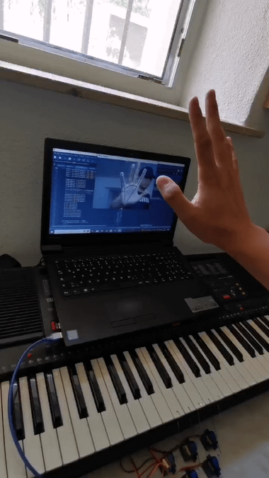
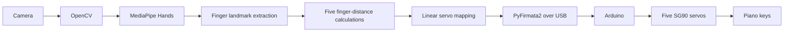

# Vision-Based Robotic Piano

A personal mechatronics project that uses camera-based hand tracking to control
five SG90 servo motors. Each servo mechanically presses one piano key. The
software preserves continuous finger-distance-to-servo control rather than
classifying fingers as simply open or closed.

## Demo



[Download or view the full MP4 demonstration](media/demo.mp4)

The relative MP4 link above opens the committed file; it is not claimed to be
an embedded player. For a GitHub-native player, upload `media/demo.mp4` as a
GitHub attachment after publishing the repository, then place the generated
GitHub-hosted URL alone in its own README paragraph. See
[Native GitHub video player](#native-github-video-player) for exact steps.

## System overview



The current implementation processes the first detected hand. MediaPipe
landmarks are converted from normalized coordinates to image pixels. Five
Euclidean distances are calculated between each fingertip and the base joint
used by the original project:

| Finger | Landmark pair | Input distance | Output servo angle |
| --- | ---: | ---: | ---: |
| Thumb | 4–1 | 50–220 px | 150–0° |
| Index | 8–5 | 20–150 px | 150–0° |
| Middle | 12–9 | 20–150 px | 150–0° |
| Ring | 16–13 | 20–150 px | 150–0° |
| Little | 20–17 | 20–150 px | 150–0° |

`numpy.interp` clips values outside the input ranges and linearly maps values
inside them. The result is rounded and inverted, preserving the original
continuous mapping.

## Hardware

- Arduino-compatible board with USB serial connection
- Five SG90 micro servos
- USB webcam or IP camera stream
- External regulated servo power supply sized for the actual mechanical load
- Five-key mechanical linkage to the piano
- Jumper wires and a shared ground connection

Servo signal assignments are fixed to the original wiring:

| Servo | Arduino pin |
| ---: | ---: |
| 1 | D4 |
| 2 | D5 |
| 3 | D6 |
| 4 | D7 |
| 5 | D8 |

See [Hardware setup](docs/hardware_setup.md) before applying power.

## Software

- Python
- OpenCV
- MediaPipe Hands
- NumPy
- PyFirmata2
- Arduino IDE and the Arduino Firmata library for the supplied sketch

Package versions are intentionally not pinned because this repository has not
been runtime-tested in a clean target environment. MediaPipe wheel availability
depends on the operating system, architecture, and Python version. Use a
64-bit Python version supported by the currently available MediaPipe release,
and install the requirements together in a clean virtual environment.

## Installation

1. Clone the repository and enter it:

   ```bash
   git clone https://github.com/timeflowsinyou/Vision-Based-Robotic-Piano.git
   cd Vision-Based-Robotic-Piano
   ```

2. Create and activate a virtual environment:

   ```powershell
   py -m venv .venv
   .\.venv\Scripts\Activate.ps1
   python -m pip install --upgrade pip
   python -m pip install -r requirements.txt
   ```

3. Connect the servos and their power supply as described in
   [docs/hardware_setup.md](docs/hardware_setup.md).

4. In Arduino IDE, install/select the Firmata library, open
   `arduino/pyfirmata2.ino`, select the correct board and port, and upload it.
   This supplied sketch is a minimal ServoFirmata-style implementation, not
   the full StandardFirmata example. Do not follow instructions that assume it
   provides all StandardFirmata features.

## Usage

The default camera source is USB webcam index `0`. PyFirmata2 attempts to
autodetect the Arduino port.

```powershell
python src/ArduinoHand.py
```

Specify another USB camera:

```powershell
python src/ArduinoHand.py --camera 1
```

Specify an IP camera stream and serial port:

```powershell
python src/ArduinoHand.py --camera "http://192.168.1.50:8080/video" --port COM3
```

Use `--width` and `--height` to request a different capture size. Camera
drivers and network streams may ignore these requests. Press `q` in the video
window to exit.

## Arduino communication

PyFirmata2 sends servo positions over the board's USB serial connection. The
supplied Arduino sketch starts Firmata at 57,600 baud, attaches a Servo object
to each supported digital pin up to the board/library limit, and handles
Firmata analog messages as servo writes. It does not implement the complete
StandardFirmata callback set.

The sketch was retained unchanged so its behavior and provenance header remain
visible. Compatibility between this legacy minimal sketch, a particular board,
and the installed PyFirmata2/Firmata library versions must be verified on the
target hardware.

## Known limitations

- Hardware operation has not been validated as part of this repository cleanup.
- Pixel distances vary with camera resolution, hand scale, and viewing angle.
- Only the first detected hand controls the servos.
- There is no smoothing, rate limiting, calibration UI, or loss-of-hand pose.
- Servo travel is fixed at 0–150° and must be checked against the linkage before
  powering the mechanism.
- The program requires a desktop display for the OpenCV preview window.
- The minimal Arduino sketch is servo-specific and is not full StandardFirmata.

## Possible improvements

- Add an explicit calibration workflow for distance and safe servo endpoints.
- Normalize distances using a stable hand-size reference.
- Add configurable temporal smoothing and servo rate limits.
- Define a safe neutral position when tracking is lost.
- Add unit tests for landmark-to-angle mapping and mocked serial communication.
- Measure end-to-end latency and tracking stability on the physical system.

## Native GitHub video player

A relative link to a committed MP4 is not assumed to create an inline player.
After the public repository exists:

1. Open a new issue, pull request comment, or discussion text box in the GitHub
   web interface.
2. Drag `media/demo.mp4` into the text box and wait for the upload to finish.
3. Copy the generated GitHub-hosted attachment URL. The upload occurs as soon
   as GitHub inserts the URL, even if the draft comment is not submitted.
4. Edit this README and replace this subsection's placeholder instructions with
   that URL on a paragraph by itself.
5. Commit the README edit and verify the rendered repository page in at least
   one desktop browser before claiming that the player works.

The current MP4 is approximately 1.6 MB, uses an H.264/AVC sample entry, and is
within GitHub's documented attachment limits. GitHub recommends H.264 for broad
browser compatibility. See GitHub's documentation for
[attaching files](https://docs.github.com/en/get-started/writing-on-github/working-with-advanced-formatting/attaching-files).

## License status

No project license has been added. MIT is a suitable permissive choice for the
original Python code and documentation. PyFirmata2 itself is distributed under
the [MIT license](https://github.com/berndporr/pyFirmata2), while the Arduino
[Firmata library is LGPL-2.1](https://github.com/firmata/arduino). The supplied
sketch's own header describes that example code as public domain. Keep these
third-party notices intact, document the dependencies, and do not imply that a
project-level MIT license relicenses Firmata or the Servo library.
